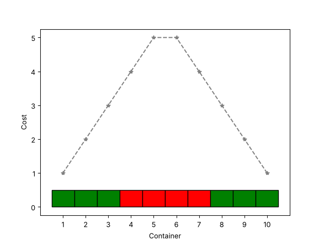
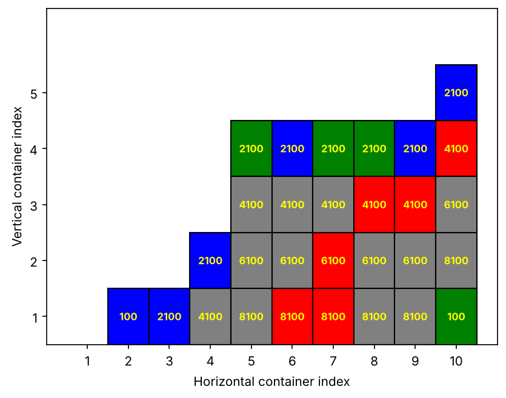

# Optimising Customs Inspections of Container Stacks

A probabilistic model of where customs should open containers to catch smuggled drugs, trading inspection cost against contraband that slips through.

**TU/e · Probability Theory and Modelling (2WS20) · 2023–24**

<!-- REPORT_LINK -->

## Model 1: a single row of crates

Crate $i$ holds drugs with probability $q_i$ and costs $c_i$ to open, with costs peaking in the middle of the row. Customs inspects crate $i$ with probability $p_i$ and minimises a weighted sum of inspection cost and missed contraband:

$$\min_{p \in [0,1]^n}\ \lambda \sum_{i=1}^{n} c_i\,p_i + (1-\lambda) \sum_{i=1}^{n} q_i\,(1 - p_i)$$

The objective is linear in $p$, so the optimum is bang-bang: inspect crate $i$ exactly when $\lambda \le q_i/(q_i + c_i)$.

 <em>Optimal rule for 10 crates with q = 0.1 and λ = 0.025: inspect the cheap outer crates (green) and skip the expensive middle (red).</em>

## Model 2: stacked containers

Containers are stacked up to $m$ high, so opening one means moving the containers above it as well, which adds a movement cost to the opening cost. The code generates random stacks, estimates by Monte Carlo how much contraband gets through, and simulates smugglers who learn from seizures and change where they hide drugs.

 <em>Example stack with the cost of opening each container. Blue: inspected and clean. Green: inspected, drugs found. Red: drugs missed. Grey: not inspected, clean.</em>

## Findings

- Inspection costs are orders of magnitude larger than the contraband term, so the optimum leans towards saving inspection cost. A proper penalty for missed drugs would need historical data.
- Learning smugglers quickly move drugs to the bottom-middle of the stack, where inspection is most expensive. The best response is then to lower the cost of each inspection and check those positions.
- When drugs are placed at random, inspecting at random is a reasonable policy.

## Repository contents

- `src/first_model.py`: the single-row model, which produces the first figure
- `src/second_model.py`: the stacked model, with a menu for an example plot, Monte Carlo estimates or the learning-smuggler simulation

**Tools:** Python · NumPy · Matplotlib
